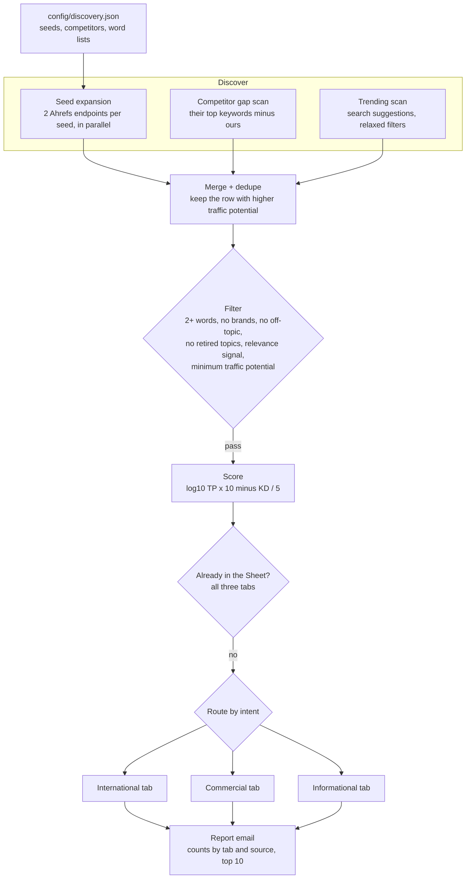

# Keyword Opportunity Finder: a content queue that refills itself from search data

A weekly job that turns a short list of seed topics into a scored, filtered list of keywords worth writing about. It expands each seed through the Ahrefs API, adds what competitors rank for and what is newly being searched, removes everything off-topic or already queued, and appends the rest to a Google Sheet, routed to the right tab by intent.

## The problem

A content pipeline that publishes every day uses up keywords faster than anyone researches them. Manual keyword research has the same shape each time: type a topic into a tool, export, delete the brand names and the off-topic rows, check what is already planned, paste in what is left. It is easy to skip for a month, and then the queue is empty.

Raw keyword exports are also mostly noise. A single seed returns competitor brand names, questions the business has no reason to answer, and near-duplicates of things already published. The value is in the filtering and the routing, and that is the part worth automating.

## What it does

`src/keyword-discovery.js` runs three discovery modes and one pipeline behind them:

| Mode | Source | What it finds |
|---|---|---|
| Seed expansion | Ahrefs matching terms and search suggestions, per seed and market | Long-tail variations under a difficulty and volume ceiling |
| Competitor gap | Each competitor's top organic keywords, compared with the site's own | Keywords a competitor ranks in the top 20 for that the site does not rank for |
| Trending scan | Search suggestions for a short list of core terms, with relaxed filters | New variations as they start to get searched |

Everything found is then merged and deduplicated, filtered, scored, checked against the Sheet, and appended as `pending` rows with a note explaining where each keyword came from and why it is worth a post.

## Architecture



## Key design decisions

**Opportunity is scored on traffic potential, not volume.** The score is `log10(traffic potential) x 10 - difficulty / 5`. Traffic potential reflects what the top-ranking page actually receives across all the queries it ranks for, and the log keeps one huge keyword from burying a dozen easy ones.

**Filtering is a chain of cheap, explainable rules.** A keyword needs at least two words, and a two-word keyword needs more traffic potential than a longer one. It must not contain a competitor brand or an off-topic term, and it must contain at least one relevance signal for the business. Each rule exists because a real bad keyword got through without it.

**Retired topics have an exception clause.** When the business stops selling something, its keywords should stop being queued, but comparison and explainer queries about it can still be worth answering. Retired terms are dropped unless the keyword also carries an exception term. The retired pattern was widened after a spacing variant of a retired product name slipped through and a post was published for it.

**The seed's market overrides the keyword's text.** A keyword found from a non-home market seed always goes to the international tab, even when the keyword itself has no language or country marker. Local-language trade terms and geo mentions route the same way, so one tab owns all international content.

**Three sources, one queue, no duplicates.** Results are deduplicated against each other, keeping the row with the higher traffic potential, and then against every keyword already in any tab of the Sheet, whatever its status. A keyword is never queued twice.

**Every row explains itself.** The note on each queued keyword records its source, the seed or competitor it came from, its volume, difficulty and traffic potential, and a callout when difficulty is very low. Whoever reads the queue, person or pipeline, can see why the row is there.

**Failures are isolated.** One failed seed, one failed competitor, or a failed trending scan is logged and the run continues with what it has.

**Callable as a module.** `runDiscovery()` is exported so a publishing pipeline can call it when its queue runs dry, instead of waiting for the weekly schedule.

**The business lives in config.** Seeds, competitors and every word list are in `config/discovery.json`. Moving the tool to another niche means editing that file, and the offline tests run the filter and routing rules against the example config.

## Repository layout

```
src/keyword-discovery.js           discovery modes, filter, scoring, routing, Sheet, report
config/discovery.example.json      example seeds, competitors and word lists
scripts/test-filters.js            offline tests for scoring, filtering and routing
scripts/fixtures/discovery.json    the config the tests run against
.github/workflows/                 weekly run
```

## Setup

Requires Node 20+, an Ahrefs API v3 token, and a Google Sheet with three tabs (`Commercial`, `Informational`, `Wholesale` by default) shared with a service account. Columns: Keyword, Status, Notes, Format, URL, Date, Error.

```bash
npm install
npm test                                                  # offline, no keys needed
cp .env.example .env                                      # fill in values
cp config/discovery.example.json config/discovery.json    # your seeds and word lists
npm run seeds                                             # list configured seeds
npm run dry-run                                           # discover and print, write nothing
npm run discover
```

| Variable | Purpose |
|---|---|
| `AHREFS_API_TOKEN` | Keywords Explorer and Site Explorer data |
| `BLOG_SHEET_ID`, `GOOGLE_SERVICE_ACCOUNT_PATH` | The queue Sheet and the service account that writes to it |
| `SITE_DOMAIN` | Your own domain, for the competitor gap scan. The scan is skipped without it |
| `GMAIL_USER`, `GMAIL_APP_PASSWORD`, `EMAIL_NOTIFY` | Optional report email |
| `SHEET_TAB_COMMERCIAL`, `SHEET_TAB_INFORMATIONAL`, `SHEET_TAB_WHOLESALE` | Tab names |
| `COMPANY_NAME`, `CONFIG_DIR` | Optional overrides |

Word lists in the config are regex fragments, so `pods?` or `roast(ed|er|ing)?` work as written.

Scheduled runs are off by default. Set the repository variable `ENABLE_SCHEDULE` to `true` to turn the schedule on; manual runs from the Actions tab always work.

---

Extracted from a production automation suite I built and ran for a live e-commerce and B2B wholesale business, 2026.

© Michael Wootan. Source shared for portfolio review; all rights reserved.
